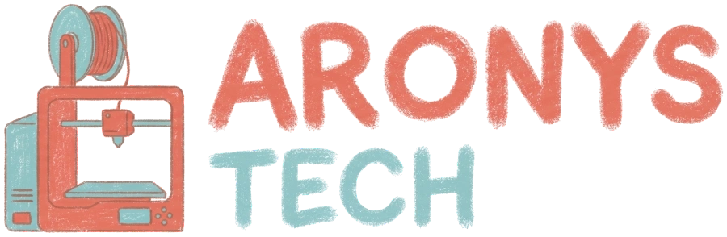
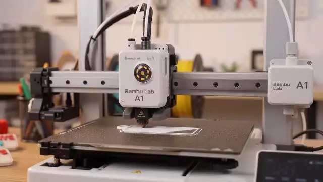
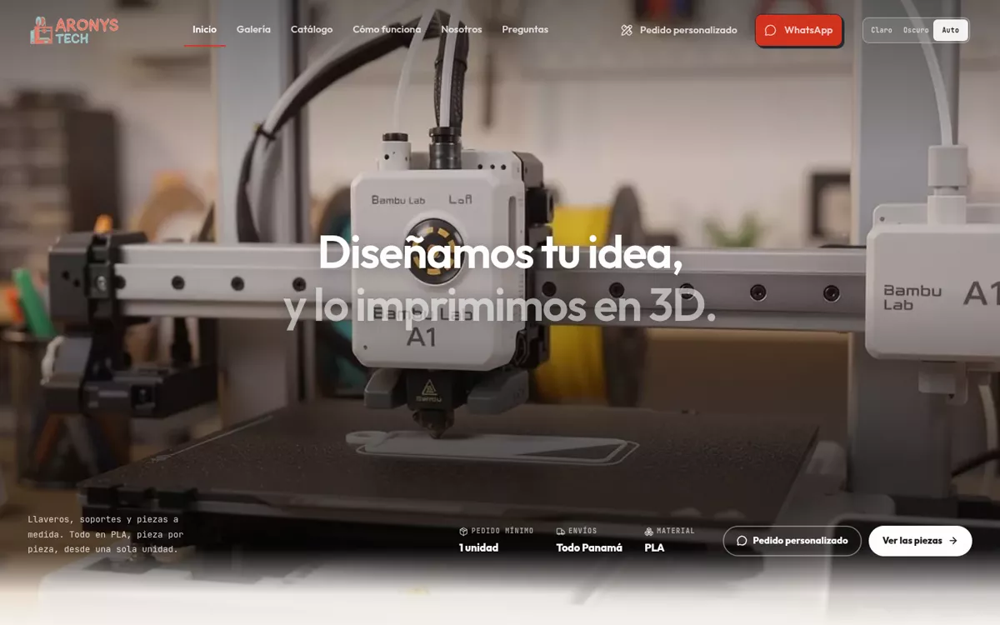
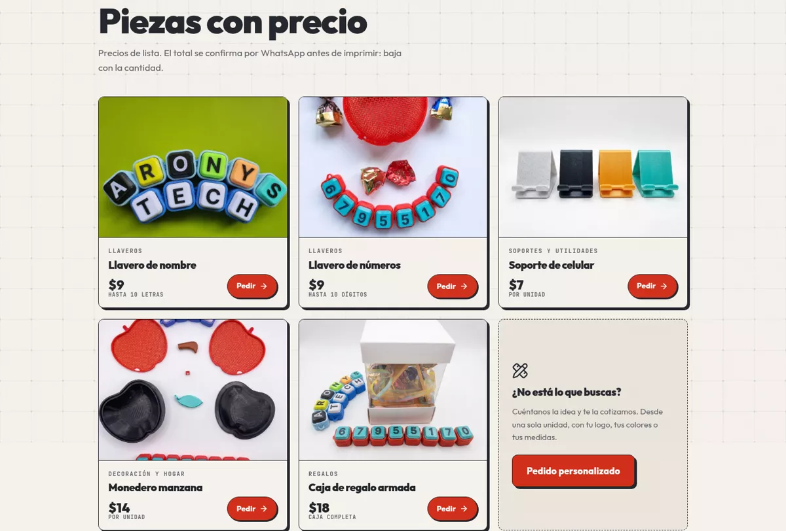
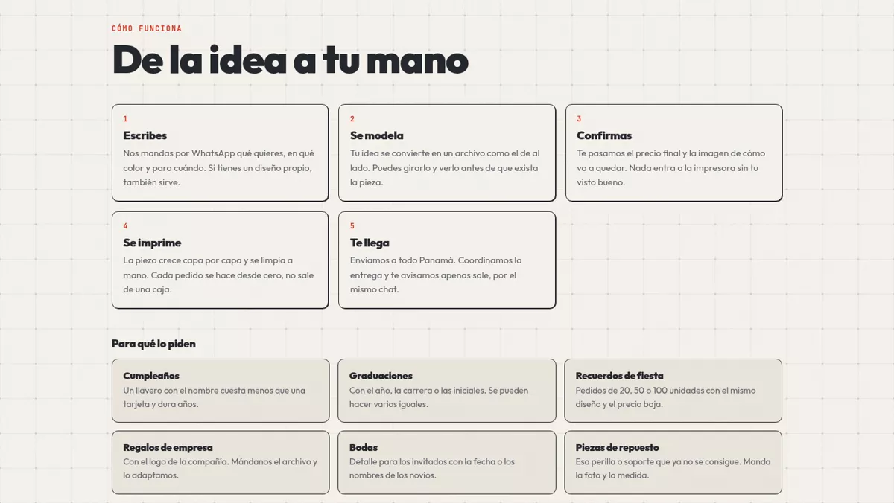
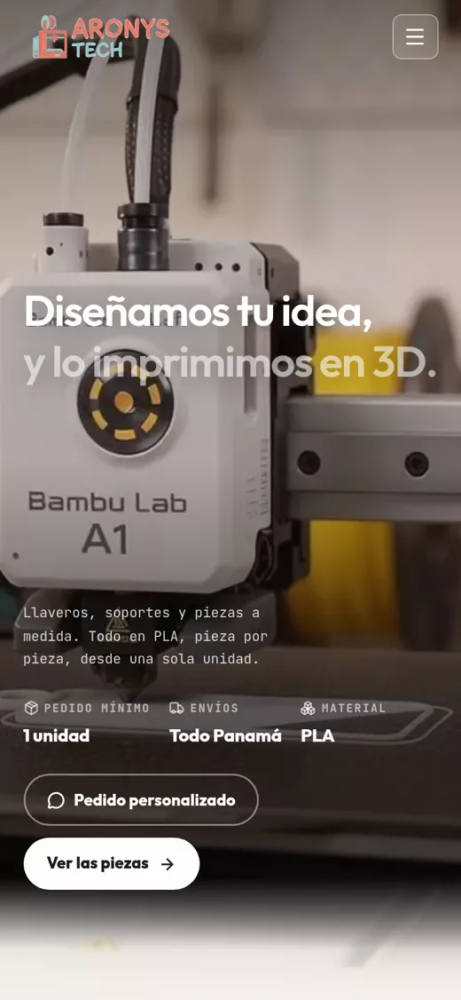
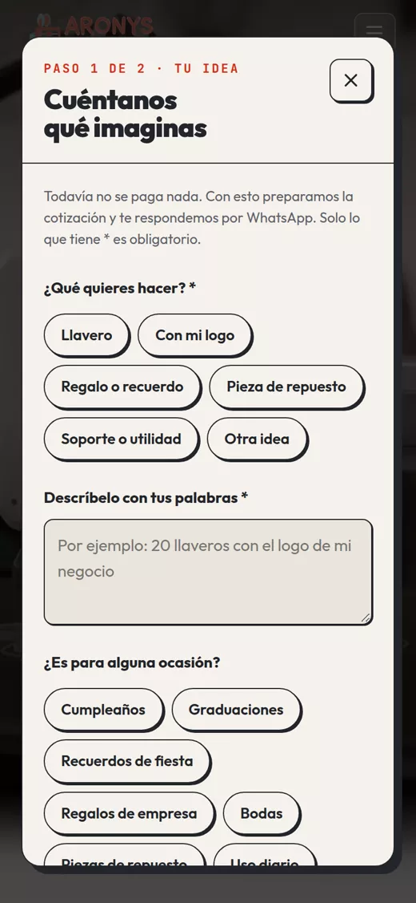

<p align="center">
  
</p>

<p align="center">
  <strong>Diseñamos tu idea, y lo imprimimos en 3D.</strong><br />
  Llaveros, soportes y piezas a medida en Panamá. En PLA o PETG, pieza por pieza, desde una sola unidad.
</p>

<p align="center">
  
</p>

---

## Qué es

AronysTech es un taller chico de impresión 3D en Panamá. Este repositorio es su
sitio web: una sola página donde se ven las piezas, sus precios y cómo se pide.
No hay carrito ni cuentas: cada pedido termina en WhatsApp con el mensaje ya
escrito, y el precio final se confirma por el chat antes de imprimir nada.

## Qué tiene la página

| Sección | Qué muestra |
|---|---|
| **Portada** | El video de la impresora sacando el llavero, el titular y los datos clave: pedido mínimo de 1 unidad, envíos a todo Panamá y material PLA. |
| **Galería** | Una pieza, el pistón de clic, que se arma y se desarma a medida que bajas. |
| **Catálogo** | Las piezas con precio de lista: llaveros de nombre y de números, soportes de celular, monederos y cajas de regalo. Cada una tiene su ficha con fotos, colores y el botón para pedirla. |
| **Cómo funciona** | Los cinco pasos, de "escribes" a "te llega", y las ocasiones para las que más se piden: cumpleaños, graduaciones, bodas, regalos de empresa, repuestos. |
| **Nosotros** | Cómo trabaja el taller: por encargo, a mano y sin stock; cada pieza se hace desde cero. |
| **Preguntas** | Las dudas de siempre (si se derrite al sol, cuánto tarda, si puedo mandar mi diseño) y los medios de pago: efectivo, Yappy, tarjeta, PayPal y cripto. |
| **Pedido personalizado** | Un formulario en dos pasos para lo que no está en el catálogo: qué quieres, para qué ocasión, cuántas y en qué colores. Al final arma el mensaje de WhatsApp solo. |

También tiene modo claro y oscuro, se adapta al celular y respeta a quien pidió
menos movimiento en su sistema: en ese caso ni siquiera se baja el video.

<p align="center">
  
</p>

<p align="center">
  
  
</p>

<p align="center">
  
  &nbsp;&nbsp;
  
</p>

## Contacto

Los pedidos se hacen por WhatsApp al **+507 6795 5170**.

---

## Para trabajar en el sitio

React 19 con Vite, sin backend ni base de datos. Tipografías propias (Outfit y
JetBrains Mono) e iconos de `lucide-react`; no hay más dependencias.

## Correr el sitio

```bash
npm install      # solo la primera vez
npm run dev      # abre http://localhost:5173
```

Para generar la versión que se publica:

```bash
npm run build    # deja todo en dist/
npm run preview  # ver esa versión ya compilada
```

## Dónde está cada cosa

```
index.html            la cáscara: título, descripción, iconos
src/
  main.jsx            arranque de React
  App.jsx             el orden de las secciones y el salto por #hash
  data/sitio.js       TODO el contenido editable: precios, textos, preguntas
  components/         una sección de la página por archivo, con su .css al lado
  hooks/              sección activa del menú, salto por ancla y la entrada
                      escalonada de las grillas al hacer scroll
  lib/whatsapp.js     arma los enlaces de WhatsApp (el número vive en data/sitio.js)
  lib/tema.js         claro / oscuro, y lo que quedó guardado
  styles/global.css   colores, tamaños y espacios comunes
public/
  img/                las fotos que usa la página
                      (la página usa los .webp; portada.jpg es para WhatsApp)
  video/              el video de la portada (hero), con su poster
  fuentes/            Outfit y JetBrains Mono, servidas desde el propio sitio
  robots.txt

docs/
  PROYECTO.md         documento maestro: qué se decidió y por qué
  STACK.md            dónde se publica y con qué base de datos
  INVESTIGACION.md    competencia, referentes y dirección de diseño
  GUIA-FOTOS.md       cómo sacar las fotos de los productos
  wireframes.html     los bocetos de los que salió la página, con su brief
  readme/             las capturas y el video corto de este README
wrangler.jsonc        cómo compila y publica Cloudflare
crudos/               fotos y videos sin comprimir, solo en tu disco (no va al repo)
```

No hay router instalado: la ficha `#producto/<id>` se mira desde el hash en
`App.jsx`, y el pedido personalizado se abre con cualquier enlace a
`#personalizado` (o `#personalizado/<tipo>`, que llega con el tipo ya elegido).
El sitio no tiene cuentas de usuario: todo pedido termina en WhatsApp.

## Cambios más comunes

- **Precio, texto o foto de un producto** → `src/data/sitio.js`, lista `PRODUCTOS`
  (salen en `#catalogo`, cada uno con su ficha en `#producto/<id>`).
- **Una pregunta frecuente** → `src/data/sitio.js`, lista `PREGUNTAS` (salen en `#preguntas`).
- **Los pasos o las ocasiones** → `src/data/sitio.js`, listas `PASOS` y `OCASIONES` (en `#proceso`).
- **Los medios de pago** → `src/data/sitio.js`, lista `PAGOS`. Salen en las preguntas
  y en el último paso del pedido, con el `detalle` de cada uno. El `icono` es un nombre
  de `lucide-react`, mapeado arriba de `components/Preguntas.jsx`.
- **El número de WhatsApp** → `src/data/sitio.js`, constantes `TEL` y `TEL_BONITO`.
- **Las redes sociales del pie** → `src/data/sitio.js`, lista `REDES` (hoy vacía).
- **Los colores de filamento** → `src/data/sitio.js`, lista `PALETA`.
- **El pedido personalizado** (tipos de pieza con su ejemplo, qué referencia
  tiene el cliente, cantidades rápidas y desde cuántas es mayoreo) →
  `src/data/sitio.js`, `TIPOS_ENCARGO`, `REFERENCIAS`, `CANTIDADES` y `MAYOREO`.

Los colores, tamaños y espacios del diseño están arriba de `src/styles/global.css`,
como variables CSS.

## Publicar

El sitio se compila a archivos estáticos: no hay servidor ni base de datos
detrás, así que sirve cualquier hosting de estáticos. Los dos valores que pide
cualquiera de ellos son siempre los mismos:

| Comando de construcción | Carpeta que se publica |
|---|---|
| `npm run build` | `dist` |

Hoy el sitio se publica en **Cloudflare**, que lee esos valores de
`wrangler.jsonc`. Cada `git push` a `main` vuelve a publicar solo; las otras
ramas suben una versión de prueba sin tocar la que está al aire.

**Netlify** también sirve: los lee de `netlify.toml`. Entras a netlify.com,
"Add new site" → "Import an existing project", eliges este repositorio de
GitHub y listo.

### Antes de publicar de verdad

Estas dos cosas hay que tocarlas o el sitio sale mal, y ninguna avisa:

1. **`public/robots.txt`** bloquea a todos los buscadores (`Disallow: /`).
   Está bien para una prueba; si sale así, Google no lo indexa nunca.
2. **Las tres direcciones absolutas de `index.html`** (`og:url`, `og:image` y
   `canonical`). Hoy apuntan a `https://aronystech-web.aronys160604.workers.dev`,
   la dirección que da Cloudflare; si el sitio pasa a un dominio propio, hay
   que cambiarlas. Son las que usan WhatsApp y Facebook para armar la vista
   previa del enlace, y tienen que ser absolutas: con una ruta relativa el
   enlace se comparte sin imagen, y el negocio se mueve por WhatsApp.

## Pendientes conocidos

- Links de Instagram y Facebook (TikTok ya está) (`REDES` en `src/data/sitio.js`).
- Dominio propio: se va a comprar. Cuando esté, cambiar las tres direcciones de `index.html` y abrir `robots.txt` (ver arriba).
- La zona de admin con PocketBase de `docs/STACK.md` es solo una idea: no está construida.

Las decisiones de dónde publicar y con qué base de datos están en `docs/STACK.md`.
